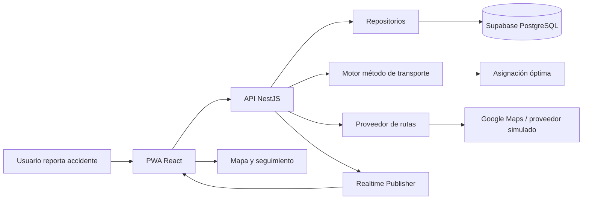

# Flujo de arquitectura

## Separación de responsabilidades

- **PWA:** captura el accidente, muestra la matriz y presenta el mapa.
- **API:** valida entradas, coordina recursos y mantiene las reglas de negocio.
- **Motor:** recibe una matriz plana y devuelve asignaciones, iteraciones y costo.
- **Repositorios:** aíslan el almacenamiento. El MVP usa memoria; Supabase es el
  adaptador persistente previsto.
- **Proveedor de rutas:** abstrae Google Maps y permite pruebas deterministas.
- **Realtime:** publica posiciones, estados y llegada sin mezclarlo con el
  cálculo matemático.

## Flujo de bloqueo

1. Se calcula la ruta principal.
2. El proveedor recibe la condición de bloqueo.
3. Se calcula una alternativa con el costo y distancia actualizados.
4. La PWA muestra ambas opciones y el estado de la ambulancia.

## Límites

El prototipo no procesa datos médicos reales, no reemplaza centrales de
emergencia y no garantiza tiempos operativos. Las ambulancias, hospitales,
bloqueos y movimientos son simulados para la demostración.
